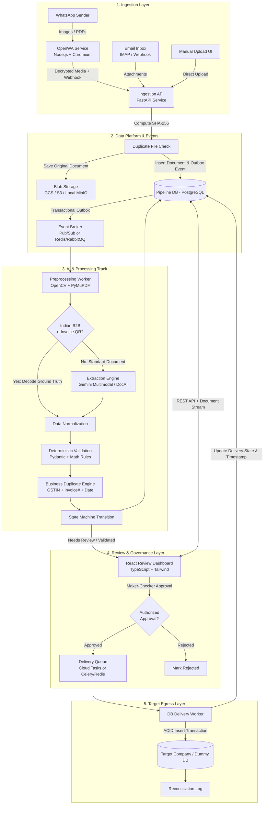
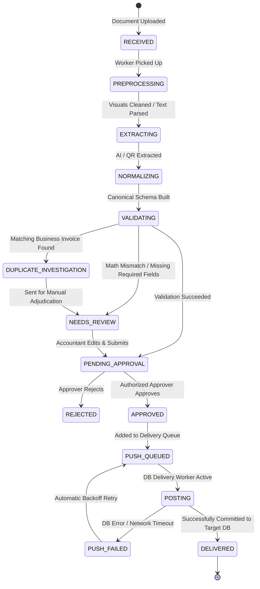

# AI Invoice Processing Pipeline — Master Engineering & Implementation Plan

**Project:** Autonomous AI Invoice Ingestion, Extraction, and Delivery Pipeline  
**Architecture:** Event-Driven, Human-Supervised, Containerized Modular Monolith  
**Portability:** Cloud-Agnostic Containerized Design (GCP, AWS, Azure, or On-Premise / Docker Compose)  
**Primary Ingestion:** OpenWA (WhatsApp Webhook Bridge), Email, Manual Upload  
**Target Destination:** Target Company / Dummy Database (Voucher & Line-Item Tables)  

---

## 1. System Architecture & End-to-End Workflow

The architecture is built on a **containerized, adapter-based design**. Cloud-specific dependencies (such as GCP Cloud Storage or Cloud Tasks) are abstracted behind adapter interfaces, allowing the entire pipeline to be deployed on **Google Cloud Platform (Cloud Run + Cloud SQL)**, **AWS / Azure**, or **locally / on-premise using Docker Compose**.

### 1.1 End-to-End System Diagram



---

## 2. Document & Invoice Lifecycle State Machine



---

## 3. Comprehensive Master Phase & Task Breakdown

---

### Phase 1: Ingestion Gateway & OpenWA Integration (Technical Track)

*Deploy a headless WhatsApp automation client and unified document intake endpoints.*

#### Sub-Phase 1.1: OpenWA Service Containerization
- [ ] **Task 1.1.1: Node.js OpenWA Service Setup**
  - [ ] Initialize Node.js project with `@open-wa/wa-automate` and TypeScript.
  - [ ] Implement headless browser startup script with optimized flags for Linux (`--no-sandbox`, `--disable-setuid-sandbox`, `--disable-dev-shm-usage`).
  - [ ] Expose an authenticated `/qr` web endpoint to view the initial pairing QR code in browser.
  - [ ] Expose an ASCII QR code output in standard stdout/logs for headless terminal pairing.
- [ ] **Task 1.1.2: Persistent Session Management ("Host Anywhere")**
  - [ ] Design session directory abstraction (`./wa_session`).
  - [ ] For GCP Cloud Run: Configure Dockerfile and mount Cloud Storage bucket via Cloud Storage FUSE to persist session tokens across container restarts.
  - [ ] For Docker Compose / VM: Map local host volume `./session_data:/app/session_data` into container.
  - [ ] Implement automatic reconnection logic on WhatsApp Web websocket disconnect.
- [ ] **Task 1.1.3: Message Interception & Media Decryption**
  - [ ] Attach `client.onMessage()` listener filtering for `message.mimetype` (`image/jpeg`, `image/png`, `application/pdf`).
  - [ ] Decrypt media stream buffer using `client.decryptMedia(message)`.
  - [ ] Extract sender metadata: phone number, sender name, message timestamp, message ID.
  - [ ] Implement WhatsApp auto-acknowledgment reply: *"Invoice received. Processing Document ID: [doc_id]..."*

#### Sub-Phase 1.2: Ingestion API Service (FastAPI)
- [ ] **Task 1.2.1: Multi-Channel Intake Endpoints**
  - [ ] `POST /api/v1/ingest/whatsapp`: Accepts multipart form-data (file buffer + sender metadata) from OpenWA.
  - [ ] `POST /api/v1/ingest/upload`: Accepts direct manual uploads from dashboard UI.
  - [ ] `POST /api/v1/ingest/email`: Accepts parsed email payload with attachments (SendGrid/Mailgun/IMAP).
- [ ] **Task 1.2.2: Document Registration & SHA-256 Hashing**
  - [ ] Compute streaming SHA-256 hash on incoming file bytes.
  - [ ] Check `documents` table for existing SHA-256 hash (File-level deduplication).
  - [ ] Upload file to Storage Abstraction Layer (GCS / S3 / Local MinIO).
  - [ ] Insert initial record into `documents` table with status `RECEIVED`.
  - [ ] Emit outbox event `DOCUMENT_RECEIVED` inside the same database transaction.

---

### Phase 2: Document Vision, Preprocessing & Fast-Paths (AI Track)

*Prepare raw documents for extraction and decode deterministic ground truth before invoking LLMs.*

#### Sub-Phase 2.1: File Classification & Page Handling
- [ ] **Task 2.1.1: File Format Router**
  - [ ] Validate MIME type using magic bytes (`python-magic`), preventing extension spoofing.
  - [ ] Split multi-page PDFs into individual page images for visualization and processing using `PyMuPDF` (`fitz`).
  - [ ] Render 300 DPI high-resolution page thumbnails for frontend viewer.
- [ ] **Task 2.1.2: Digital PDF Text Layer Extraction**
  - [ ] Attempt programmatic text extraction via `PyMuPDF`.
  - [ ] Calculate text density metric: If searchable character count $> 100$ characters per page, flag as `DIGITAL_PDF`.
  - [ ] If character count $< 100$ or document is an image, flag as `SCANNED_OR_PHOTO`.

#### Sub-Phase 2.2: OpenCV Image Preprocessing
- [ ] **Task 2.2.1: Document Geometry & Deskewing**
  - [ ] Implement Hough Line Transform or Minimum Area Bounding Box to detect skew angle.
  - [ ] Rotate image to align text horizontally (within $\pm 45^\circ$).
  - [ ] Detect orientation (0°, 90°, 180°, 270°) and correct upside-down mobile photos.
- [ ] **Task 2.2.2: Mobile Photo Optimization**
  - [ ] Apply adaptive Gaussian thresholding to enhance contrast on low-light WhatsApp photos.
  - [ ] Run bilateral filtering to remove background noise while preserving sharp character edges.

#### Sub-Phase 2.3: Indian B2B e-Invoice QR Code Fast-Path
- [ ] **Task 2.3.1: QR Code Scanner Engine**
  - [ ] Use `OpenCV` / `pyzbar` to scan for QR codes on the document.
  - [ ] Check if the payload is a signed B2B e-invoice string (contains standard GSTN signed JWT).
- [ ] **Task 2.3.2: Deterministic Data Extraction**
  - [ ] Decode GST e-invoice payload: extracts Seller GSTIN, Buyer GSTIN, Invoice Number, Invoice Date, Total Value, Item Count, and IRN.
  - [ ] If valid e-invoice QR is found: Bypass LLM OCR entirely; populate canonical schema with 100% mathematical accuracy at zero inference cost.

---

### Phase 3: AI Extraction & Schema Normalization (AI Track)

*Extract structured data from unstructured or handwritten invoices using multimodal foundation models.*

#### Sub-Phase 3.1: Canonical Invoice Schema & Pydantic Contracts
- [ ] **Task 3.1.1: Schema Definition**
  - [ ] Model `SupplierDetails`: `name`, `gstin`, `address`, `phone`, `email`.
  - [ ] Model `InvoiceMetadata`: `invoice_number`, `invoice_date`, `due_date`, `currency`, `place_of_supply`.
  - [ ] Model `LineItem`: `item_code_hsn`, `description`, `quantity`, `unit_price`, `discount`, `tax_rate`, `cgst_amount`, `sgst_amount`, `igst_amount`, `line_total`.
  - [ ] Model `TaxSummary`: `cgst_total`, `sgst_total`, `igst_total`, `cess_total`.
  - [ ] Model `InvoiceTotals`: `subtotal`, `total_discount`, `total_tax`, `round_off`, `grand_total`.
  - [ ] Model `ExtractionMetadata`: `provider`, `model_name`, `confidence_scores`, `raw_response_id`.

#### Sub-Phase 3.2: Primary Model Adapter — Gemini Multimodal (Vertex AI / Gemini API)
- [ ] **Task 3.2.1: Gemini Multimodal Client**
  - [ ] Implement adapter using `google-genai` SDK supporting both Gemini 2.5 Flash and Gemini 1.5 Pro.
  - [ ] Configure Structured Outputs enforcement via `response_schema=CanonicalInvoiceSchema`.
  - [ ] Construct domain-specific system prompt covering Indian GST rules, HSN codes, discounts, and handwritten receipts.
- [ ] **Task 3.2.2: Multimodal Payload Dispatch**
  - [ ] Send document image parts alongside prompt instructions.
  - [ ] Implement backoff and retry policy for rate-limiting (HTTP 429) and transient network disconnects.
  - [ ] Capture and persist raw JSON model response in `extractions` table.

#### Sub-Phase 3.3: Secondary Fallback Adapter — Google Document AI
- [ ] **Task 3.3.1: Document AI Client**
  - [ ] Configure `DocumentProcessorServiceClient` targeting Google Cloud Document AI **Invoice Processor**.
  - [ ] Build mapping adapter converting Document AI entities into `CanonicalInvoiceSchema`.
- [ ] **Task 3.3.2: Fallback Orchestrator**
  - [ ] Define triggering criteria for fallback: Gemini timeout, structural parse failure, or missing required primary fields (`grand_total`, `invoice_number`).
  - [ ] Seamlessly invoke Document AI when Gemini criteria fail; record provider used in audit log.

---

### Phase 4: Deterministic Validation & Deduplication (AI & Business Rules)

*Enforce strict financial arithmetic and prevent double-posting before human approval.*

#### Sub-Phase 4.1: Deterministic Arithmetic & Format Validation
- [ ] **Task 4.1.1: Indian GSTIN & Date Validator**
  - [ ] Validate 15-character alphanumeric GSTIN regex: `^[0-9]{2}[A-Z]{5}[0-9]{4}[A-Z]{1}[1-9A-Z]{1}Z[0-9A-Z]{1}$`.
  - [ ] Verify state code prefix matches the place of supply.
  - [ ] Normalize varied date inputs (`15/11/2026`, `15-Nov-2026`, `2026.11.15`) into ISO-8601 `YYYY-MM-DD`.
- [ ] **Task 4.1.2: Arithmetic Reconciliation Rules**
  - [ ] Line Item Verification: $\text{Quantity} \times \text{Unit Price} - \text{Discount} \stackrel{?}{=} \text{Line Total}$.
  - [ ] Subtotal Verification: $\sum (\text{Line Totals}) \stackrel{?}{=} \text{Subtotal}$.
  - [ ] Tax Consistency: If inter-state (Seller State $\neq$ Buyer State), $\text{CGST} = 0, \text{SGST} = 0, \text{IGST} > 0$. If intra-state, $\text{CGST} = \text{SGST}, \text{IGST} = 0$.
  - [ ] Grand Total Equation: $\text{Subtotal} + \text{CGST} + \text{SGST} + \text{IGST} \pm \text{Round-off} \stackrel{?}{=} \text{Grand Total}$.
  - [ ] Precision Tolerance: Allow maximum variance of $\pm ₹1.00$ to accommodate standard rounding discrepancies; flag larger mismatches as `MATH_ERROR`.

#### Sub-Phase 4.2: Two-Tier Deduplication Engine
- [ ] **Task 4.2.1: Layer 1 — Exact File Duplicate**
  - [ ] Compare incoming SHA-256 against `documents.file_hash`.
  - [ ] If matched, link new message to existing document, record duplicate event, and halt reprocessing.
- [ ] **Task 4.2.2: Layer 2 — Business Identity Duplicate**
  - [ ] Query database for active invoices with identical compound key: `(supplier_gstin, normalized_invoice_number)`.
  - [ ] Execute fuzzy matching on similar invoice numbers (Levenshtein distance $\le 1$ or date within $\pm 3$ days with identical total).
  - [ ] If exact match: Transition status to `DUPLICATE_REJECTED`.
  - [ ] If fuzzy match: Transition status to `DUPLICATE_INVESTIGATION` and link candidate IDs for human inspection.

---

### Phase 5: Data Platform, Storage & Outbox Engine (Technical Track)

*Construct a resilient PostgreSQL database with an outbox pattern for zero message loss.*

#### Sub-Phase 5.1: Relational Database Schema & Migrations
- [ ] **Task 5.1.1: Core Database Tables (SQLAlchemy / Alembic)**
  - [ ] `documents`: `id`, `source` (whatsapp/email/manual), `file_path`, `file_hash`, `mime_type`, `created_at`.
  - [ ] `invoices`: `id`, `document_id`, `status`, `invoice_number`, `invoice_date`, `supplier_name`, `supplier_gstin`, `subtotal`, `tax_total`, `grand_total`, `version`, `created_at`, `updated_at`.
  - [ ] `line_items`: `id`, `invoice_id`, `description`, `hsn_code`, `quantity`, `unit_price`, `tax_rate`, `line_total`.
  - [ ] `extractions`: `id`, `invoice_id`, `raw_payload`, `normalized_payload`, `provider`, `model_version`, `created_at`.
  - [ ] `validation_results`: `id`, `invoice_id`, `rule_name`, `status` (PASS/FAIL), `error_details`.
  - [ ] `approvals`: `id`, `invoice_id`, `user_id`, `action` (APPROVE/REJECT), `notes`, `snapshot_version`, `timestamp`.
  - [ ] `outbox_events`: `id`, `aggregate_type`, `aggregate_id`, `event_type`, `payload`, `status` (PENDING/PUBLISHED), `created_at`.
  - [ ] `audit_logs`: `id`, `entity_type`, `entity_id`, `actor`, `action`, `changes_json`, `timestamp`.
- [ ] **Task 5.1.2: Target Company / Dummy DB Schema**
  - [ ] `company_invoices`: `id`, `ext_reference_id`, `supplier_gstin`, `supplier_name`, `invoice_number`, `invoice_date`, `subtotal`, `tax_amount`, `grand_total`, `posted_at`.
  - [ ] `company_invoice_lines`: `id`, `company_invoice_id`, `item_description`, `hsn_code`, `quantity`, `unit_price`, `line_total`.
  - [ ] Unique constraint: `UNIQUE (supplier_gstin, invoice_number)` on `company_invoices` to enforce absolute idempotency.

#### Sub-Phase 5.2: Storage Abstraction Layer ("Host Anywhere")
- [ ] **Task 5.2.1: Unified Blob Storage Adapter Interface**
  - [ ] Abstract class `StorageProvider`: `upload(path, bytes)`, `download(path) -> bytes`, `get_signed_url(path, ttl) -> str`.
  - [ ] Implement `GoogleCloudStorageProvider` (using `google-cloud-storage`).
  - [ ] Implement `S3StorageProvider` (for AWS or MinIO using `boto3`).
  - [ ] Implement `LocalStorageProvider` (for local filesystem / single VM deployments).

#### Sub-Phase 5.3: Transactional Outbox Worker
- [ ] **Task 5.3.1: Outbox Publisher Process**
  - [ ] Implement an asynchronous polling loop querying `outbox_events WHERE status = 'PENDING' FOR UPDATE SKIP LOCKED`.
  - [ ] Publish events to Queue Adapter (Google Cloud Pub/Sub, Redis Streams, or RabbitMQ).
  - [ ] Mark event as `PUBLISHED` upon confirmed broker acknowledgment.

---

### Phase 6: Human-in-the-Loop Review Dashboard (Technical Track)

*Build an intuitive web interface for accountants to inspect, edit, and approve invoices.*

#### Sub-Phase 6.1: Frontend Application Setup (React + TypeScript)
- [ ] **Task 6.1.1: Project Scaffolding & State Management**
  - [ ] Initialize React 18 + TypeScript + Vite project with Tailwind CSS and `shadcn/ui`.
  - [ ] Configure React Query (TanStack Query) for resilient server-state caching and polling.
  - [ ] Implement JWT/OIDC authentication handling and role-based route guards (`Accountant`, `Approver`, `Admin`).

#### Sub-Phase 6.2: Operational Views & Review Workspace
- [ ] **Task 6.2.1: Invoice Queue Table**
  - [ ] Build filterable table: Filter by Status (`Needs Review`, `Pending Approval`, `Delivered`), Source, Date, Supplier.
  - [ ] Display visual badges for math validation status, duplicate warnings, and extraction confidence.
- [ ] **Task 6.2.2: Split-Screen Review Workspace**
  - [ ] **Left Pane (Document Viewer):** High-performance PDF/Image canvas viewer supporting zoom, pan, rotate, and multi-page flipping.
  - [ ] **Right Pane (Data & Line-Item Grid):**
    - Editable header fields (Invoice #, Date, Supplier GSTIN).
    - Dynamic tabular line-item editor (Add, Delete, Modify quantities, prices, and tax rates).
    - Real-time arithmetic recalculation bar: dynamically alerts user if edited line items do not sum to total.
  - [ ] **Audit Trail Panel:** Collapsible timeline displaying original extraction values vs user edits.

#### Sub-Phase 6.3: Maker-Checker Governance & Actions
- [ ] **Task 6.3.1: Approval Workflow Security**
  - [ ] Prevent self-approval: If User A edited/submitted an invoice, disable the "Approve" button for User A (requires User B with `Approver` role).
  - [ ] Optimistic Concurrency Control: Include `version` in approve/edit requests. Reject with HTTP 409 if another user modified the record concurrently.
  - [ ] Action buttons: `Save Draft`, `Submit for Approval`, `Approve & Post to DB`, `Reject with Reason`.

---

### Phase 7: Delivery Worker & Target/Dummy DB Egress (Technical Track)

*Deliver approved invoices into the target company database with rate-limiting and guaranteed idempotency.*

#### Sub-Phase 7.1: Task Queueing Abstraction ("Host Anywhere")
- [ ] **Task 7.1.1: Queue Adapter Interface**
  - [ ] Abstract class `QueueProvider`: `enqueue_task(queue_name, payload, delay_seconds)`.
  - [ ] Implement `GoogleCloudTasksProvider` (target GCP Cloud Tasks for rate-limiting).
  - [ ] Implement `CeleryRedisQueueProvider` (for Docker Compose, AWS, or on-prem deployment).

#### Sub-Phase 7.2: Target Database Delivery Worker
- [ ] **Task 7.2.1: Idempotent Egress Worker**
  - [ ] Worker receives task `invoice_id` to post.
  - [ ] Verify invoice status is strictly `APPROVED` in `pipeline_db`.
  - [ ] Begin transaction on Target / Dummy DB:
    ```sql
    INSERT INTO company_invoices (ext_reference_id, supplier_gstin, invoice_number, ...)
    VALUES (...) ON CONFLICT (supplier_gstin, invoice_number) DO NOTHING;
    ```
  - [ ] If conflict detected: Record existing ID, log idempotency notice, and mark pipeline status as `DELIVERED_ALREADY_EXISTS`.
  - [ ] If successful insert: Insert all line items; commit transaction.
- [ ] **Task 7.2.2: Reconciliation & Pipeline Update**
  - [ ] Update pipeline record status to `DELIVERED` with target DB record ID and timestamp.
  - [ ] Write audit entry: `INVOICE_POSTED_TO_TARGET_DB`.
  - [ ] If target DB is unreachable: Raise exception to trigger exponential backoff retry in queue (retry up to 5 times before moving to Dead-Letter Queue).

---

### Phase 8: Multi-Cloud Deployment & Container Orchestration (Technical Track)

*Ensure the entire application can run on GCP or anywhere via standard Docker configurations.*

#### Sub-Phase 8.1: Containerization ("Run Anywhere")
- [ ] **Task 8.1.1: Multi-Stage Dockerfiles**
  - [ ] `Dockerfile.backend`: Python 3.12 slim base, installs OpenCV dependencies, runs FastAPI via `uvicorn`.
  - [ ] `Dockerfile.openwa`: Node.js 20 base, installs Chromium and required OS libraries, launches OpenWA daemon.
  - [ ] `Dockerfile.frontend`: Node.js build stage, outputs static assets served via NGINX.
- [ ] **Task 8.1.2: Local Development & On-Prem Deployment (`docker-compose.yml`)**
  - [ ] Orchestrate entire pipeline in one command:
    - `openwa`: Port 8085 (WhatsApp Webhook + QR)
    - `backend-api`: Port 8000 (FastAPI)
    - `frontend`: Port 3000 (React UI)
    - `pipeline-db`: Port 5432 (PostgreSQL)
    - `target-dummy-db`: Port 5433 (PostgreSQL - Simulating Company ERP)
    - `redis`: Port 6379 (Queue & Outbox broker for local/on-prem runs)
    - `minio`: Port 9000 (S3-compatible local blob storage)

#### Sub-Phase 8.2: Primary Target — GCP Cloud Hosting
- [ ] **Task 8.2.1: GCP Infrastructure Provisioning (Terraform / gcloud)**
  - [ ] **Cloud Storage:** Bucket `invoice-docs-prod` for files; bucket `openwa-session-prod` for WhatsApp auth state.
  - [ ] **Cloud SQL:** PostgreSQL 16 instance hosting both `pipeline_db` and `dummy_company_db`.
  - [ ] **Secret Manager:** Store `GEMINI_API_KEY`, database passwords, and JWT secrets.
- [ ] **Task 8.2.2: Cloud Run Deployment**
  - [ ] Deploy `backend-api` to Cloud Run (Autoscaling: 1 to 10 instances).
  - [ ] Deploy `openwa-service` to Cloud Run:
    - Set `--min-instances=1 --max-instances=1` (Prevents WhatsApp multi-login conflicts).
    - Allocate **2 GiB RAM** and **2 vCPUs**.
    - Configure Cloud Storage FUSE volume mount pointing `/app/session_data` to `openwa-session-prod`.
  - [ ] Deploy `frontend` to Cloud Run or Cloud Storage + Cloud CDN.
  - [ ] Configure **Cloud Tasks** queue `invoice-posting-queue` with rate limit (e.g., max 5 dispatches/second to prevent DB lockups).

---

### Phase 9: Testing, Verification & Demo Runbook (Testing Track)

*Prove that the pipeline handles clean PDFs, blurry phone photos, duplicates, and approvals.*

#### Sub-Phase 9.1: Automated Evaluation Suite
- [ ] **Task 9.1.1: Golden Dataset Evaluation**
  - [ ] Assemble 30 diverse test invoices (10 Clean PDFs, 10 WhatsApp mobile photos, 5 Handwritten receipts, 5 Indian e-Invoices with QR).
  - [ ] Build automated test runner comparing extracted JSON against human-labeled ground truth.
  - [ ] Generate accuracy scorecards: Target $>95\%$ precision on Invoice #, Date, GSTIN, and Grand Total.
- [ ] **Task 9.1.2: Idempotency & Fault Injection Tests**
  - [ ] Test Duplicate Submission: Send identical invoice 3 times via WhatsApp $\rightarrow$ verify only 1 entry reaches Target DB.
  - [ ] Test DB Disconnect: Simulate Target DB outage during Cloud Task delivery $\rightarrow$ verify exponential backoff and successful delivery upon DB recovery.

#### Sub-Phase 9.2: Live Demonstration Script
- [ ] **Demo Step 1 (WhatsApp Intake):** Send an invoice photo from a physical smartphone to the OpenWA number. Show real-time WhatsApp acknowledgment.
- [ ] **Demo Step 2 (Automated Extraction):** Open the React Dashboard. Show the document appearing in `Needs Review` or `Pending Approval` with all fields extracted and math checked.
- [ ] **Demo Step 3 (Maker-Checker Review):** Edit an item's quantity in the UI. Show the math engine recalculating totals dynamically. Submit for approval.
- [ ] **Demo Step 4 (Target DB Commit):** Log in as Approver, click "Approve". Show the invoice status change to `DELIVERED`.
- [ ] **Demo Step 5 (Target DB Verification):** Open PostgreSQL terminal on the Target Dummy DB and run:
  ```sql
  SELECT * FROM company_invoices WHERE invoice_number = '...';
  SELECT * FROM company_invoice_lines WHERE company_invoice_id = '...';
  ```
  Prove that the financial record has been created with perfect ledger accuracy.

---

## 4. Database Schema Definitions (DDL)

```sql
-- ============================================================================
-- PIPELINE DATABASE (Operational Source of Truth)
-- ============================================================================

CREATE TYPE invoice_status AS ENUM (
    'RECEIVED', 'PREPROCESSING', 'EXTRACTING', 'NORMALIZING', 
    'VALIDATING', 'NEEDS_REVIEW', 'DUPLICATE_INVESTIGATION', 
    'PENDING_APPROVAL', 'APPROVED', 'REJECTED', 
    'PUSH_QUEUED', 'POSTING', 'DELIVERED', 'PUSH_FAILED'
);

CREATE TABLE documents (
    id UUID PRIMARY KEY DEFAULT gen_random_uuid(),
    source VARCHAR(32) NOT NULL, -- 'whatsapp', 'email', 'manual'
    source_sender VARCHAR(64),   -- Phone number or email
    file_path VARCHAR(512) NOT NULL,
    file_hash CHAR(64) NOT NULL, -- SHA-256
    mime_type VARCHAR(64) NOT NULL,
    created_at TIMESTAMPTZ DEFAULT NOW()
);

CREATE UNIQUE INDEX idx_documents_file_hash ON documents(file_hash);

CREATE TABLE invoices (
    id UUID PRIMARY KEY DEFAULT gen_random_uuid(),
    document_id UUID REFERENCES documents(id) ON DELETE CASCADE,
    status invoice_status DEFAULT 'RECEIVED',
    supplier_name VARCHAR(256),
    supplier_gstin VARCHAR(15),
    invoice_number VARCHAR(128),
    invoice_date DATE,
    currency VARCHAR(3) DEFAULT 'INR',
    subtotal NUMERIC(12, 2),
    tax_total NUMERIC(12, 2),
    grand_total NUMERIC(12, 2),
    version INT DEFAULT 1,
    created_at TIMESTAMPTZ DEFAULT NOW(),
    updated_at TIMESTAMPTZ DEFAULT NOW()
);

CREATE INDEX idx_invoices_business_id ON invoices(supplier_gstin, invoice_number);

CREATE TABLE line_items (
    id UUID PRIMARY KEY DEFAULT gen_random_uuid(),
    invoice_id UUID REFERENCES invoices(id) ON DELETE CASCADE,
    hsn_code VARCHAR(16),
    description TEXT NOT NULL,
    quantity NUMERIC(10, 3) DEFAULT 1,
    unit_price NUMERIC(12, 2) NOT NULL,
    discount NUMERIC(12, 2) DEFAULT 0,
    tax_rate NUMERIC(5, 2) DEFAULT 0, -- e.g. 18.00
    line_total NUMERIC(12, 2) NOT NULL
);

CREATE TABLE extractions (
    id UUID PRIMARY KEY DEFAULT gen_random_uuid(),
    invoice_id UUID REFERENCES invoices(id) ON DELETE CASCADE,
    provider VARCHAR(64) NOT NULL, -- 'gemini-2.5-flash', 'document-ai', 'b2b-qr'
    model_version VARCHAR(64),
    raw_payload JSONB NOT NULL,
    confidence_scores JSONB,
    created_at TIMESTAMPTZ DEFAULT NOW()
);

CREATE TABLE outbox_events (
    id UUID PRIMARY KEY DEFAULT gen_random_uuid(),
    aggregate_type VARCHAR(64) NOT NULL,
    aggregate_id UUID NOT NULL,
    event_type VARCHAR(64) NOT NULL,
    payload JSONB NOT NULL,
    status VARCHAR(16) DEFAULT 'PENDING', -- 'PENDING', 'PUBLISHED', 'FAILED'
    retry_count INT DEFAULT 0,
    created_at TIMESTAMPTZ DEFAULT NOW()
);

-- ============================================================================
-- TARGET COMPANY / DUMMY DATABASE (Simulating Company ERP / Ledger)
-- ============================================================================

CREATE TABLE company_invoices (
    id UUID PRIMARY KEY DEFAULT gen_random_uuid(),
    ext_pipeline_id UUID NOT NULL,
    supplier_gstin VARCHAR(15) NOT NULL,
    supplier_name VARCHAR(256) NOT NULL,
    invoice_number VARCHAR(128) NOT NULL,
    invoice_date DATE NOT NULL,
    subtotal NUMERIC(12, 2) NOT NULL,
    tax_amount NUMERIC(12, 2) NOT NULL,
    grand_total NUMERIC(12, 2) NOT NULL,
    posted_at TIMESTAMPTZ DEFAULT NOW(),
    CONSTRAINT uq_company_invoice UNIQUE (supplier_gstin, invoice_number)
);

CREATE TABLE company_invoice_lines (
    id UUID PRIMARY KEY DEFAULT gen_random_uuid(),
    company_invoice_id UUID REFERENCES company_invoices(id) ON DELETE CASCADE,
    hsn_code VARCHAR(16),
    item_description TEXT NOT NULL,
    quantity NUMERIC(10, 3) NOT NULL,
    unit_price NUMERIC(12, 2) NOT NULL,
    line_total NUMERIC(12, 2) NOT NULL
);
```

---

## 5. Technology Stack Summary ("Host Anywhere")

| Component | GCP Cloud Target | Alternative / On-Prem / Local Target |
| :--- | :--- | :--- |
| **Ingestion Gateway** | OpenWA container on Cloud Run (GCS FUSE) | OpenWA container in Docker Compose (Host Volume) |
| **API & Extraction Backend** | FastAPI on Cloud Run | FastAPI container in Docker Compose / Kubernetes |
| **AI Models** | Gemini 2.5 Flash / Document AI | Gemini API via API Key / Local Ollama / vLLM |
| **Computer Vision** | OpenCV + PyMuPDF | OpenCV + PyMuPDF |
| **Relational Databases** | Google Cloud SQL (PostgreSQL 16) | PostgreSQL 16 container / On-Prem DB |
| **Blob File Storage** | Google Cloud Storage (GCS) | AWS S3 / MinIO S3-compatible container / Local Disk |
| **Event Messaging** | Google Cloud Pub/Sub | Redis Streams / RabbitMQ container |
| **Delivery Task Queue** | Google Cloud Tasks | Celery + Redis |
| **Frontend UI** | React + TypeScript on Cloud Run / CDN | React + TypeScript served via NGINX container |
| **Secret Management** | Google Secret Manager | `.env` / Docker Secrets / HashiCorp Vault |

---

## 6. Execution Roadmap for Demo Delivery

```
[Sprint 1: Days 1-4]   --> Implement Phase 2 & 3: Extraction script + Gemini adapter + Pydantic validation.
[Sprint 2: Days 5-8]   --> Implement Phase 5 & 7: PostgreSQL schema, outbox, and Target Dummy DB writer.
[Sprint 3: Days 9-13]  --> Implement Phase 1: OpenWA container, QR login, and webhook forwarder to FastAPI.
[Sprint 4: Days 14-20] --> Implement Phase 6: React dashboard with split document viewer & approval buttons.
[Sprint 5: Days 21-25] --> Implement Phase 8: Deploy all containers to GCP (Cloud Run, Cloud SQL, GCS session).
[Sprint 6: Days 26-28] --> Implement Phase 9: Run golden test suite and live WhatsApp-to-Database demonstration.
```
